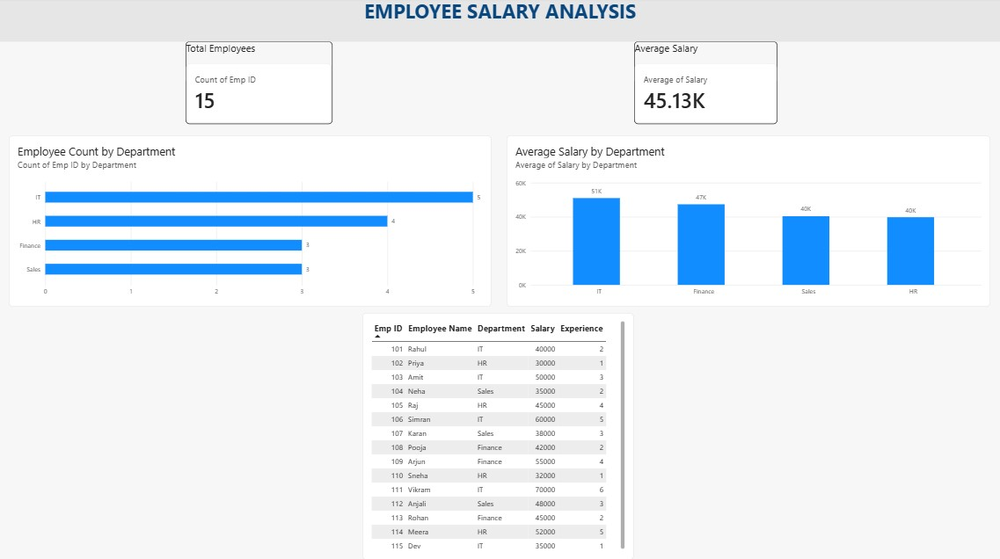

# Employee Salary Analysis

## Project Overview

Employee Salary Analysis is a data analysis project that explores employee salary information using **Microsoft Excel, MySQL, and Power BI**.

The purpose of this project is to analyze employee data, understand salary distribution across departments, and present meaningful insights through visualizations.

## Tools & Technologies

- **Microsoft Excel** – Data analysis, formulas, PivotTables, and charts.
- **MySQL** – Data storage, filtering, sorting, and SQL queries.
- **Power BI** – Interactive dashboard and data visualization.

## Dataset Information

The dataset contains 15 employee records with the following columns:

- Employee ID
- Employee Name
- Department
- Salary
- Experience

## Project Work

### 1. Excel Analysis

- Created an employee salary report.
- Used formulas such as COUNT, SUM, AVERAGE, MAX, MIN, COUNTIF, AVERAGEIF, and SUMIF.
- Created department-wise salary summaries.
- Built a PivotTable to analyze employee count, average salary, and total salary by department.
- Created charts to visualize department-wise employee count and average salary.

### 2. MySQL Analysis

- Created the EmployeeAnalysis database and Employees table.
- Inserted 15 employee records.
- Retrieved and filtered employee information.
- Used ORDER BY and DISTINCT.
- Applied aggregate functions such as COUNT, SUM, AVG, MIN, and MAX.
- Used GROUP BY and HAVING for department-wise analysis.
- Retrieved the top 3 highest-paid employees.

### 3. Power BI Dashboard

Created an employee salary dashboard containing:

- Total Employees (KPI Card)
- Average Salary (KPI Card)
- Department-wise Employee Count (Bar Chart)
- Department-wise Average Salary (Column Chart)
- Employee Salary Comparison (Table)

## Power BI Dashboard Preview



## Key Learning Outcomes

- Practiced data cleaning and analysis using Excel.
- Improved SQL querying and database management skills.
- Learned to create reports and visualizations using Power BI.
- Understood how to analyze employee and department-wise salary information.
- Gained practical experience working with multiple data analysis tools.

## Project Structure

```text
Employee-Salary-Analysis/
│
├── Excel/
│   └── Employee_Salary_Report.xlsx
│
├── SQL/
│   └── Employee_Analysis.sql
│
├── PowerBI/
│   └── Employee_Salary_Dashboard.pbix
│
├── Employee_Salary_Dashboard.png
│
└── README.md
```

## Project Status

**Version 1 – Completed**

## Author

**Yug Popaliya**

GitHub: [YugPopaliya-17](https://github.com/YugPopaliya-17)
